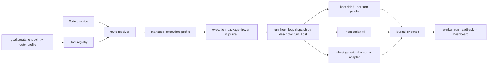

# LoopX 多运行时、模型路由与执行快照改动计划

## 0. 依据与勘查结论

依据：[prd/PRD-LoopX-多运行时与能力注入及模型路由-v1.1.md](prd/PRD-LoopX-多运行时与能力注入及模型路由-v1.1.md)（v1.0 原稿已被其修正）。源码勘查由 4 个 Grok 4.6 子代理完成，关键事实如下：

- Worker 关键路径硬编码 DSH：
  - [loopx/control_plane/worker_catalog.py](loopx/control_plane/worker_catalog.py) 中 `WORKER_KINDS` 只有 `dsh_coding_worker`；
  - `admit_worker` 无条件调用 `probe_dsh_cli`（约 308 行）；`WorkerDescriptor.runtime()` 永远返回 `DshCliRuntime`；
  - [loopx/dsh_goal_mode/governed_turn_loop.py](loopx/dsh_goal_mode/governed_turn_loop.py) 的 `run_host_loop` 在 485-515 行固定拼 `--host dsh --dsh-runner`。
- `turn run-once` 已支持 `codex-cli / dsh / generic-cli`（[loopx/cli_commands/turn_registration.py](loopx/cli_commands/turn_registration.py) 18-21 行）。generic-cli 的协议是 stdin 输入 `loopx_turn_host_request_v0`、stdout 输出一个 `loopx_turn_result_v0`，由 `validate_loopx_turn_host_result` 严格校验字段，进程监督归 TS `host_process.ts`。仓库里还没有任何 Cursor `agent` 的 headless Turn 适配器；现有 `cursor-agent` 只是 skill facade 加 MCP 的宿主面。
- 模型解析的唯一 owner 是 [loopx/control_plane/turn_driver/execution_profile.py](loopx/control_plane/turn_driver/execution_profile.py) 中的 `managed_execution_profile()`，优先级为显式参数、环境变量、产品默认。各路径现状：
  - DSH SDK 真正生效；
  - DSH CLI 把 model/effort 记为 `UNSUPPORTED_ARGV_CONTROLS`（[dsh_cli_runner.py](loopx/dsh_goal_mode/dsh_cli_runner.py) 91-98 行），但它支持 `--patch <cordis.yml>`，这是可用的每次执行注入口；
  - Codex CLI 只认 `--codex-model / --codex-reasoning-effort`，不经过 managed profile；
  - Goal 和 Todo 契约里都没有模型字段。
- Journal 的语义 owner 是 TS（`turn_journal.ts` / `turn_journal_effects.ts`）。约束：
  - 顶层 `loopx_turn_journal_v0` 必须精确匹配，没有迁移器；
  - `plan` 和终态 tombstone 都不可变；
  - host result 是封闭字段集。
  因此 Execution Package 只能作为 journal 与 host request 里的嵌套版本化对象，不能放进 host stdout。
- Dashboard 现状：
  - [goal-create-request.ts](apps/presentation/dashboard/src/features/personal-workspace/goal-create-request.ts) 和 `workspace-action-form.tsx` 写死 `dsh-coding-worker-local`；
  - `chat.ts` 的 zod schema 会丢掉 `governed_turn_workers`；
  - `goal.create` 的字段白名单在 [loopx/chat_action_normalization.py](loopx/chat_action_normalization.py) 487-504 行。
- GES 在代码中不存在。`project_skill_delivery` 的 surface 列表不含 cursor 和 dsh。`packages/loopx-jev` 是 HTTP 方式的 off/shadow progress_review 观察器；LoopX 核心没有 MCP client，只有 `packages/loopx-ark-turn` 里有可参考的 stdio `ClientSession`。

## 1. 命名与 owner 决策（避免与既有 profile 冲突）

- 产品概念 “Runtime Profile” 在代码中命名为 `worker_route_profile`。它与 Goal 的 `execution_profile`（cadence 节奏画像）、`managed_execution_profile`（模型行）、`SchedulerRuntimeProfile`（调度宿主）、`manager_runtime_profile`（权限）都分开。
- 解析的唯一入口：Todo 覆盖 > Goal 默认 > `worker_route_profile` > endpoint 默认。这个链路只负责产出显式参数，然后交给 `managed_execution_profile(provider=, model=, reasoning_effort=)`。在 source 枚举中增加 `todo_override / goal_default / route_profile` 三个来源，不另造第二套默认系统。
- Worker 选择与准入继续由 Python 的 `worker_catalog` 负责（TS 目前没有对应的 owner）；Execution Package 的不可变规则放在 TS 的 journal write admission 中。
- 新增的闭集字面量（worker kind、turn_host、route source、package schema 版本）每一项都要先跑 `uv run python scripts/generate_semantic_inventory.py --changed-from HEAD`，并在 PR 中说明它属于以下哪一类：复用既有 owner、扩展已注册词汇、仅本地使用，还是新建共享契约。

## 2. Phase 1 交付切片（按 PR 拆分，均从最新 origin/main 的 codex/ worktree 出发，git commit -s）

### PR-1 Worker Catalog 多运行时与按 endpoint 分派（FR-01/02/05）
- 修改 [worker_catalog.py](loopx/control_plane/worker_catalog.py)：
  - 新增 `codex_cli_coding_worker`、`cursor_cli_coding_worker` 两种 kind，以及 descriptor 字段 `turn_host`（取值 `dsh | codex-cli | generic-cli`）和 `capabilities`（是否支持指定模型、可用 effort 集合、是否支持 resume、权限模式）；
  - 按 kind 分派 probe，DSH 仍用 `probe_dsh_cli`，Codex 和 Cursor 分别新增 probe；准入失败时使用细分原因：未安装、未认证、模型不可用、版本不兼容；
  - 每个 endpoint 各有一个默认关闭的独立 flag（`LOOPX_CODEX_CODING_WORKER`、`LOOPX_CURSOR_CODING_WORKER`），`LOOPX_DSH_CODING_WORKER` 保持原语义。
- 修改 [governed_turn_loop.py](loopx/dsh_goal_mode/governed_turn_loop.py)：`run_host_loop` 读取 Goal 的 `worker_endpoint_id`，并按 `descriptor.turn_host` 构造对应的 argv。DSH 的 argv 必须与现有完全一致，这是回归基线。
- 测试：扩展 `tests/test_worker_catalog.py` 和 `tests/test_governed_turn_loop.py`，覆盖多 endpoint、非 DSH 端点不触发 DSH probe、flag 关闭时保持现状（AC-01、AC-02、AC-31）。

### PR-2 任务级模型解析并真实生效（FR-03/07，AC-08/09/10）
- 新增 `loopx/control_plane/turn_driver/worker_route.py`：
  - 解析 Todo 覆盖、Goal 默认和 `worker_route_profile`，再调用 `managed_execution_profile`；
  - 按 endpoint 的 `capabilities` 校验模型和 effort，显式指定但无效时直接拒绝，不回退到默认值。
- Todo 契约（[todos/contract.py](loopx/control_plane/todos/contract.py)）新增可选字段 `worker_model`、`worker_reasoning_effort`。Goal registry（`bootstrap.py`）新增可选字段 `worker_route_profile` 和 `worker_model_default`。旧数据缺少这些字段时按“未指定”处理。
- DSH CLI：在 `dsh_cli_runner.py` 中为每个 Turn 生成独立的 cordis patch 文件（放在 turn 私有目录，不碰共享的 `$DSH_HOME/profiles`），通过 `--patch` 传入，并把对应字段移出 `UNSUPPORTED_ARGV_CONTROLS`。同时从 NDJSON 中解析观测到的模型；解析不到时标记为 unknown。
- Codex CLI：在 `turn_run_once.py` 中让 codex 分支也经过 `managed_execution_profile`。当它与 `--codex-model` 冲突时显式拒绝。
- 测试：重写 `test_dsh_cli_runner.py` 中“unsupported 仅记录”的断言（这是默认行为变更，需在 PR 中披露）；扩展 `test_turn_managed_executor_binding.py`；新增两个 Todo 使用不同模型的 argv/patch 隔离测试（AC-12）。

### PR-3 Cursor CLI Coding Worker 适配器（FR-04，AC-04/05/06）
- 新增 `loopx/cursor_worker/turn_host_adapter.py`（结构仿照 `dsh_goal_mode/turn_host_adapter.py`），通过 generic-cli 接缝接入：
  - stdin 读取 host request，用显式 argv 调用 Cursor CLI：命令名通过 probe 在 `agent` 和 `cursor-agent` 之间探测，固定 `--print --output-format stream-json`，必须带 `--model`，resume 只用明确的 session id；
  - 把 Cursor 事件转换为 `loopx_turn_result_v0`，结果无法解析时 fail-closed 为 `wait`；
  - 非零退出、只有 stderr 输出、缺少 result 事件、JSON 损坏，这些情况一律不得判为完成；
  - 不加 force/yolo，不自动信任工作区；跨模型 resume 一律新开 session。
- 测试：用伪 CLI fixture 覆盖上述负面用例；真实 `agent` 集成测试作为 D-03 的人工验收项，测试环境不可用时如实记录为证据缺口，不跳过冒充通过。

### PR-4 Execution Package 与证据扩展（FR-08/13/14，AC-11/22/23/26/27/28）
- 在 `executor.py` 第一次 `persist_journal` 之前，构建并写入嵌套对象 `execution_package`（schema `loopx_turn_execution_package_v0`）。内容包括：
  - 身份：goal_ref、todo_id、turn_key、turn_instance_id；
  - endpoint 与 runtime 版本、模型解析的 requested/resolved/applied 及各自来源、route profile 版本；
  - session 策略、baseline commit 和 workspace dirty 摘要。
  同一份对象镜像到 `build_loopx_turn_host_request`，launcher 只读这份快照。
- 在 TS 的 `turn_journal_effects.ts` 写准入中加入规则：`execution_package` 写入后不可变（与 `plan` 同规则）。缺少该字段的旧 journal 一律视为 unknown，不伪造历史。
- 结算后补写的证据：observed model、usage（缺失记为 unknown，不写成 0）、真实 start/end 时间、diff 文件清单摘要。这些作为 journal 的嵌套 `execution_observation` 写入，host result 的封闭字段集保持不变。
- `worker_run_readback.py` 增加投影字段：runtime kind、四段模型信息、route 来源；不投影 session、本地路径和原始 diff。
- 测试：启动后修改 Goal 默认，验证原尝试不受影响（AC-11）；在各阶段注入故障，验证恢复时不会重复执行 Host（复用现有 journal 恢复测试，AC-23）；旧 journal 仍可读取（AC-31）。

### PR-5 Dashboard 配置与回显（FR-14、第 9 节，AC-29）
- `apps/presentation/dashboard/src/data/chat.ts`：把 `governed_turn_workers` 加入 zod schema。
- `workspace-action-form.tsx` 和 `goal-create-request.ts`：选择 Worker 后，从 catalog 列出 endpoint，并按 capabilities 展示模型和 effort 选项；保持 Chat 与 Worker 的互斥关系，Chat 路径的 payload 不变。
- [chat_action_normalization.py](loopx/chat_action_normalization.py) 的白名单增加 `worker_route_profile` 和 `worker_model_default`，preview 阶段校验。
- `worker-runs-card.tsx`：显示 runtime 和四段模型信息，诊断信息折叠展示，`recorded_at` 继续标明来源是 mtime。
- 按 `docs/development/design.md` 和 `frontend-delivery.md` 在打包后的前端里走通流程，包括 endpoint 不可用、模型无效两个失败用例。动到首屏时先给用户预览。

## 3. Phase 2A / 2B（外部契约确认前只做设计，不写代码）

- 2A GES：放在 `capability_id=project-skill-delivery`、`provider_id=loopx-ges`、目录 `packages/loopx-ges/`。前置工作是把 surface 扩展到 cursor（`CURSOR_HOME/skills` 或项目内 `.cursor`）和 dsh；复用现有的 preview/apply、拒绝覆盖、digest 校验和 readback。阻塞项：D-01（GES 的仓库、schema、安装安全契约）。
- 2B Jev：新增能力 `runtime-model-recommendation`，provider 为 `packages/loopx-jev-routing/`，内置 stdio MCP client（参考 loopx-ark-turn）。模式 off/shadow/enforce 单独建 schema，不复用观察器的 off/shadow，也不复用 progress_review 的 assist。enforce 只能输出候选 ID，再进入 `worker_route.py` 校验。阻塞项：D-02（MCP 服务来源、工具 schema、认证方式）。
- 以上两项作为路线图 S4/S8 下的待办，在 Phase 1 合并后各自写 RFC checkpoint。

## 4. 交付与验证约束

- 所有 PR 都改动 `loopx/**` 或 `apps/**`，属于控制面/产品面，不得自合并，需要发布 exact-head review。
- 每个 PR 运行 `uv run --extra test python -m pytest` 的相关测试集，并跑 `loopx canary premerge --from-git-diff`。
- 验收矩阵 AC-01 到 AC-32 初始状态全部为“未执行”。真实 Cursor/Codex/DSH 账号集成属于 D-03/D-04 门控，环境不可用时如实报告为证据缺口。
- PRD 两个文件当前未跟踪，是否纳入仓库（需先去除私有上下文）另行确认，不混入代码 PR。
